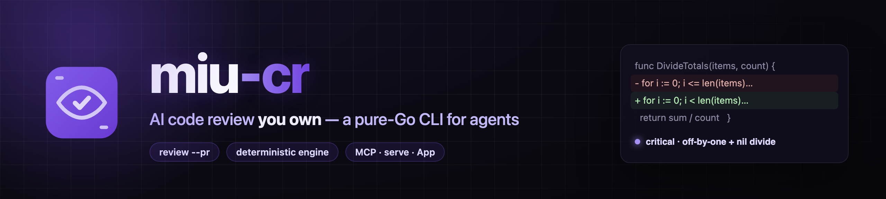

<p align="center"></p>

<p align="center">
  <a href="https://github.com/vanducng/miu-cr/releases"></a>
  <a href="https://go.dev"></a>
  <a href="LICENSE"></a>
</p>

# miu-cr

AI code review for your terminal, CI, and coding agents. Deterministic engine, the model only for judgment, stable JSON on stdout.

**Docs:** [cr.miu.sh](https://cr.miu.sh) · agents: append `.md` to any docs URL, or read [`llms.txt`](https://cr.miu.sh/llms.txt)

## Get started


```sh
curl -fsSL https://cr.miu.sh/install.sh | sh
curl -fsSL https://cr.miu.sh/skill.md --create-dirs \
  -o ~/.claude/skills/miucr/SKILL.md
```

Then ask your agent:

```text
/miucr set up miucr for this repo: check my provider login, add a starter rule
for this stack, then review my staged changes and summarize the findings.
```

Or by hand:

```sh
miucr init                                   # provider, auth, starter rule
miucr review --staged -o pretty              # review what you are about to commit
miucr review --from main --to HEAD --gate high   # branch check, exit 2 on high+
miucr review --pr owner/repo#123 --post      # inline comments on a GitHub PR
```

Other installs (Homebrew, Windows, `go install`): [Install](https://cr.miu.sh/install/). More commands: [Getting started](https://cr.miu.sh/onboarding/).

## Develop

```sh
go build ./cmd/miucr   # single static binary (CGO_ENABLED=0)
go test ./...          # table tests + fakes, no live network or LLM
```

**Agent skill:** [`.agents/skills/miucr/SKILL.md`](.agents/skills/miucr/SKILL.md) (agent-agnostic); `.claude/skills/miucr` is a symlink to it.

## License

Apache-2.0. See [LICENSE](LICENSE).
